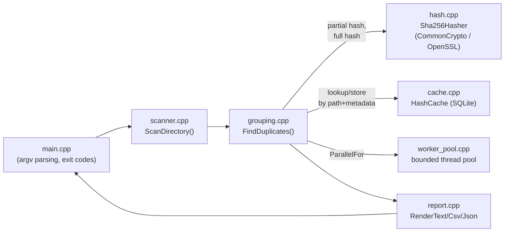

# duplicate-file-analyzer

A C++20 CLI that finds duplicate files on disk by content — and never deletes, moves, or
modifies anything. It only reports.

## Problem

Duplicate-file finders are a classic systems exercise because the obvious approach (hash every
file and compare) is wasteful at scale: hashing every byte of every file is expensive I/O and CPU
for files that are almost certainly not duplicates (different sizes can't be duplicates; files
that differ in their first few KiB don't need their last few GiB read). The interesting work is in
the staged filtering pipeline, correctly handling hardlinks/symlinks so "reclaimable space" claims
are actually true, and bounding memory/threads so the tool can run against a real filesystem
without crashing or using everything on the machine. Equally interesting: this tool is what a
careless version of it could do a lot of damage, so "never delete" is treated as a hard,
test-enforced invariant, not just a UI nicety.

## Features

- Recursive scan with `--exclude` glob patterns (matched against full path or bare filename).
- Four-stage filtering pipeline: group by size → partial hash (first+last 64 KiB) → full SHA-256 →
  optional byte-for-byte comparison.
- SHA-256 via the OS-provided crypto library (CommonCrypto on macOS, OpenSSL on Linux) behind one
  interface — this project never implements its own hash primitive.
- Symlinks are never followed by default (files or directories). Hardlinks are detected
  (same `dev`+`inode`) and excluded from "reclaimable bytes" — they already share one allocation.
- SQLite cache keyed by `(path, size, mtime, inode, dev)`; a changed file is a structural cache
  miss, no explicit invalidation needed.
- Bounded worker pool (`--jobs N`) for the hashing stages; never spawns more threads than requested
  or than there are items to process.
- Text, CSV, and JSON report formats; `--output` to write to a file.
- No deletion code path exists in `src/` or `include/` at all — enforced by a test that greps the
  production source for forbidden tokens (`unlink`, `remove`, `rename`, `truncate`, ...).

## Architecture



## Module-by-module walkthrough

- **`scanner.cpp`** (`ScanDirectory`): walks the tree with
  `std::filesystem::recursive_directory_iterator`, recording `(path, size, mtime, inode, dev)` per
  regular file. Symlinks are skipped unconditionally (see Design decisions). Per-entry errors
  (permission denied, race-deleted file) are collected into `ScanResult::errors` instead of
  aborting the whole scan — one unreadable subdirectory shouldn't blank the entire report.
- **`glob.cpp`** (`GlobMatch`): thin wrapper over POSIX `fnmatch`. Not reimplemented by hand, same
  reasoning as not reimplementing SHA-256: libc's glob matching is already correct.
- **`hash.cpp`** (`Sha256Hasher`, `PartialFileHash`, `FullFileHash`): a pimpl'd streaming hasher
  with two backends selected at compile time (`DFA_USE_COMMONCRYPTO` / `DFA_USE_OPENSSL`, set by
  CMake per-platform). `PartialFileHash` reads only the first and last `window` bytes (default
  64 KiB); `FullFileHash` streams the whole file in bounded chunks so memory use doesn't grow with
  file size.
- **`cache.cpp`** (`HashCache`): one SQLite table, `Get`/`Put` keyed by path with the row's
  recorded metadata compared against the file's current metadata. A mismatch is a miss, and
  writing a hash for one kind (partial/full) invalidates the *other* kind's cached value too if the
  metadata changed — it was computed for different bytes.
- **`worker_pool.cpp`** (`ParallelFor`): runs `work(i)` for `i` in `[0, count)` across exactly
  `num_workers` threads using an atomic work-stealing index, with all exceptions collected and the
  earliest (by index) rethrown after every worker finishes. Below `kMinItemsToParallelize` (32)
  items it runs on the calling thread — see Design decisions for why that threshold exists.
- **`grouping.cpp`** (`FindDuplicates`): the pipeline itself. Groups by size first (free — already
  known from `stat`), then partial-hashes survivors, then full-hashes survivors of that, then
  optionally byte-compares. Every hashing stage is one flat `ParallelFor` call across the *entire*
  candidate set for a size bucket, not one call per sub-bucket (see Design decisions — this was the
  specific bug fixed in this build).
- **`report.cpp`** (`RenderText`/`RenderCsv`/`RenderJson`, `TotalReclaimableBytes`): pure
  formatting, no I/O, so it's trivially unit-testable and reusable for `--output`.
- **`main.cpp`**: argv parsing, exit codes, and wiring the above together. No business logic lives
  here.

## Data flow

1. `ScanDirectory(root)` → `vector<FileRecord>` (+ errors).
2. `FindDuplicates(files, options)`:
   a. Bucket by `size`.
   b. For each bucket with ≥2 members: partial-hash every member (parallel), keep only members
      whose partial hash collides with another member's (i.e., drop groups of size 1).
   c. Full-hash every surviving candidate across the *whole* bucket in one parallel pass, group by
      full hash, drop singleton groups again.
   d. If `--verify`, byte-compare within each full-hash group and split any false positive apart
      (SHA-256 collisions aren't a realistic concern, but the option exists — see
      `AnalyzeOptions::verify_byte_compare`).
3. `RenderText/Csv/Json(groups)` → stdout or `--output` file.

## Design decisions and trade-offs

- **Flatten the full-hash stage across the whole size bucket, not per partial-hash sub-bucket.**
  The first version of this pipeline ran stage 3 (full hash) once per partial-hash bucket. For a
  size bucket with many small sub-buckets, that meant spawning and joining a worker-pool's threads
  once per sub-bucket — fixed thread-spawn/join cost paid repeatedly instead of once. A benchmark
  run caught this directly: with partial hashing enabled, the *parallel* full-hash stage was
  measurably slower than skipping partial hashing and full-hashing everything in one pass, despite
  reading more total bytes. The fix (`grouping.cpp`'s `full_hash_candidates` flattening) runs stage
  3 exactly once per size bucket regardless of how many partial-hash sub-buckets it was split into.
  Rejected alternative: a persistent thread pool shared across stages (avoids spawn/join entirely)
  — correct, but adds lifetime/shutdown complexity this CLI's single-shot-per-run usage doesn't
  need; flattening the call sites was the smaller fix for the actual bottleneck.
- **`kMinItemsToParallelize = 32` (worker_pool.cpp).** Measured directly: spawning OS threads for a
  handful of sub-millisecond hash computations costs more than doing them serially. Below 32 items,
  `ParallelFor` runs on the calling thread. This number is a measured threshold for this machine and
  workload, not a universal constant — documented as such rather than presented as derived.
- **Symlinks are never followed, by default, with no flag to opt in.** Following symlinks in a
  duplicate scanner risks infinite loops (symlink cycles) and reporting "duplicates" that are
  actually the same inode reached two ways, which would misstate reclaimable space. Treating
  symlinks as opaque (skip, don't follow) is the safe default for a tool whose output might
  eventually inform a deletion decision, even though this tool itself never deletes.
- **Hardlinks are detected and excluded from reclaimable-byte counts, not from duplicate groups.**
  Hardlinked files are still reported together (they are, in fact, identical), but
  `ReclaimableBytes()` only counts distinct `(dev, inode)` pairs minus one, because removing one
  hardlink's directory entry frees zero bytes — the data is still referenced by the other link.
  Reporting them as duplicates while being honest about reclaimability was chosen over silently
  dropping hardlinked groups, since a user might still want to know their hardlink structure.
- **The cache's `HashCache` serializes all access behind one `std::mutex`.** The worker pool calls
  into the same `HashCache*` from multiple threads. A single mutex per cache instance is simple and
  trivially correct (no risk of SQLite's own locking semantics interacting badly with concurrent
  connections), and the measured cost is low because hashing (CPU/I/O), not a SQLite point lookup,
  dominates wall-clock time per item. Rejected alternative: a sharded cache (e.g., per-worker SQLite
  connections) — more throughput under contention, but unjustified complexity for a cache whose
  entire point is to be cheaper than the hash it replaces.
- **CommonCrypto / OpenSSL behind one interface, never a hand-rolled SHA-256.** Cryptographic
  primitives are exactly the kind of code where "I'll just implement it myself" is a liability, not
  a learning opportunity worth the risk, in a tool meant to be trustworthy about file identity.
- **Benchmarked against a separate Release build (`build-release/`), not the Debug build used for
  day-to-day development.** `-O3 -DNDEBUG` matters a lot for a CPU-bound hashing pipeline; an
  unoptimized binary would make every benchmarked scenario I/O-bound and hide the actual
  differences being measured. The Debug build (and the ASan/UBSan/TSan builds, which are also
  Debug) stay separate build directories so one `rm -rf build && ./scripts/build_and_test.sh`
  doesn't need to know about the Release tree, and so sanitizer instrumentation never leaks into
  benchmark numbers.
- **No "delete" or "quarantine" feature, ever.** This wasn't a time-boxing decision — it's a
  product boundary, test-enforced by `tests/test_no_deletion.cpp`, which greps `src/` and
  `include/` (not `tests/`, which legitimately creates and destroys its own temp fixtures) for
  tokens like `unlink(`, `remove(`, `rename(`, `truncate(`/`O_TRUNC`/`ftruncate` and fails the build
  if any appear. A tool that reports what *could* be deleted should not itself be one incautious
  patch away from deleting it.

## Complexity analysis

Let `n` = number of files, `s` = average file size, `k` = number of distinct sizes among
duplicates, `w` = partial-hash window (64 KiB).

- Scan: `O(n)` stat calls, `O(n)` memory for `FileRecord`s.
- Size grouping: `O(n log n)` (ordered `std::map` keyed by size; chosen for deterministic
  iteration order over `unordered_map`, which matters for reproducible report ordering).
- Partial hash stage: `O(n · w)` I/O and hashing work (bounded per file regardless of file size),
  `O(n)` additional memory for the keys.
- Full hash stage: `O(m · s̄)` where `m ≤ n` is the number of partial-hash survivors and `s̄` their
  average size — this is the stage partial hashing exists to shrink.
- Memory: `O(n)` for `FileRecord`s plus `O(1)` per file being hashed at any instant (streaming, not
  loading whole files) — bounded by `window` for partial hashes, by the read-chunk size for full
  hashes, independent of file size.
- Parallelism: each hashing stage is `O(total work / num_workers)` wall-clock, ignoring the fixed
  per-call thread spawn/join cost that `kMinItemsToParallelize` exists to amortize.

## Build / run / test

### macOS / Linux

```bash
git clone <this-repo> && cd duplicate-file-analyzer
./scripts/build_and_test.sh   # Debug + ASan + UBSan + TSan, all via CTest
```

Requires CMake ≥ 3.16, a C++20 compiler, SQLite3 dev headers, and on Linux, OpenSSL dev headers
(`libsqlite3-dev libssl-dev` on Debian/Ubuntu; `brew install sqlite openssl` is not required on
macOS since CommonCrypto and `libsqlite3` ship with the OS). If `cmake` isn't on `PATH`, the script
bootstraps a project-local copy into `.venv/` via pip — no global install, no sudo.

Run the CLI directly:

```bash
cmake --build build
./build/duplicate-file-analyzer /path/to/scan --exclude '*.git/*' --jobs 8 --format json
```

Exit codes: `0` success, `2` usage/IO error (bad args, root not a directory, cache file
unwritable). There is no "duplicates found" exit code distinct from success — finding duplicates is
the expected, successful outcome of running this tool, not an error condition.

### Benchmarks

```bash
cmake -S . -B build-release -DCMAKE_BUILD_TYPE=Release -DBUILD_TESTS=OFF
cmake --build build-release
./benchmarks/run_benchmarks.sh
```

Writes `results/benchmark.csv` and `results/metadata.txt` (both gitignored — regenerated per
machine, never committed, so the numbers below are a labeled snapshot, not a claim that the CSV in
your checkout will match).

## Demo walkthrough (real output)

```
$ ./build/duplicate-file-analyzer /tmp/tmp.ovOVkeN0kO
Group 1: 3 files, 12 bytes each, sha256=a948904f2f0f479b8f8197694b30184b0d2ed1c1cd2a1ec0fb85d299a192a447, reclaimable=24 bytes
  /tmp/tmp.ovOVkeN0kO/sub/b.txt
  /tmp/tmp.ovOVkeN0kO/sub/d.txt
  /tmp/tmp.ovOVkeN0kO/a.txt

Total reclaimable: 24 bytes across 1 group(s)
$ echo $?
0
```

(`a.txt`, `sub/b.txt`, `sub/d.txt` all contain `"hello world\n"`; `c.txt` contains `"different\n"`
and correctly does not appear in any group.) The same scan with `--format json`:

```json
{
  "total_reclaimable_bytes": 24,
  "groups": [
    {
      "size": 12,
      "sha256": "a948904f2f0f479b8f8197694b30184b0d2ed1c1cd2a1ec0fb85d299a192a447",
      "reclaimable_bytes": 24,
      "paths": [
        "/tmp/tmp.ovOVkeN0kO/sub/b.txt",
        "/tmp/tmp.ovOVkeN0kO/sub/d.txt",
        "/tmp/tmp.ovOVkeN0kO/a.txt"
      ]
    }
  ]
}
```

## Benchmark methodology and measured results

Measured on this Mac on **2026-11-23**:

- Machine: Apple M1 (`Darwin 27.0.0`, `arm64`)
- Logical CPUs: 8
- Compiler: Apple clang version 21.0.0 (clang-2100.3.34.2)
- Build: Release (`-O3 -DNDEBUG`, `build-release/`)
- Dataset: 200 duplicate files across 40 content groups (2 MiB each) + 60 same-size, unique-content
  files (2 MiB each) — 520 MiB total, generated fresh per run by `benchmarks/run_benchmarks.sh`
- OS page cache warmed (every file read once) before timing, so every scenario below pays the same
  near-zero disk-I/O cost and the numbers isolate CPU-side effects (hashing, thread spawn/join,
  SQLite overhead) rather than disk variance.

| Scenario | Wall time (s) |
|---|---|
| Full pipeline (partial + full hash, no cache), `--jobs 1` | 1.0517 |
| Full pipeline (partial + full hash, no cache), `--jobs 8` | 0.1596 |
| No partial hash (full hash only, no cache), `--jobs 8` | 0.1245 |
| With cache, cold (first run, populates cache), `--jobs 8` | 0.4123 |
| With cache, warm (second run, same dataset, all hits), `--jobs 8` | 0.0247 |

Raw CSV: `results/benchmark.csv` (gitignored, regenerate with `./benchmarks/run_benchmarks.sh`).

**Reading these numbers honestly:**

- `--jobs 1` → `--jobs 8` is a **6.6x** speedup on 8 logical cores for the full-hash stage — not
  8x, because thread spawn/join and the atomic work-stealing index are real (if small) fixed costs,
  and this M1 is 4 performance + 4 efficiency cores, not 8 uniform cores.
- **Partial hashing was *not* faster than skipping it in this run** (0.1596s vs 0.1245s) — with the
  OS page cache warm, disk I/O is nearly free, so the bytes partial hashing avoids reading (all 60
  unique files' full contents) don't cost much to begin with, while the partial-hash stage still
  pays for an *extra* full parallel pass (spawn/join a worker pool a second time) before the
  full-hash stage runs. This is the real, measured finding, not a flaw in the benchmark: partial
  hashing's benefit is biggest when disk I/O is genuinely expensive (spinning disks, network
  filesystems, cold cache) relative to thread spawn overhead, and this dataset with a warmed page
  cache on a fast SSD doesn't exercise that case. It is documented here instead of tuned away,
  because asserting a benefit the data doesn't show would be worse than admitting the benchmark's
  honest limits.
- **Cache cold (0.4123s) is slower than no-cache-at-all (0.1596s/0.1245s)** — populating the cache
  means an extra SQLite `INSERT` per file on top of the hash work itself, paid once.
- **Cache warm (0.0247s) is the fastest scenario by far** — 6.5x faster than the full pipeline
  without a cache, because every hash becomes a SQLite point lookup instead of a file read +
  SHA-256 computation. This is the cache's actual value proposition: it pays for itself on the
  *second* scan of an unchanged tree, not the first.

## Testing strategy

47 GoogleTest cases across 7 files, run under plain Debug, AddressSanitizer, UndefinedBehaviorSanitizer,
and ThreadSanitizer (`./scripts/build_and_test.sh` runs all four configurations):

- `test_glob.cpp` — exact match, `*`/`?` wildcards, path-pattern matching.
- `test_hash.cpp` — known SHA-256 test vectors (empty string, `"hello"`), chunked vs. single
  `Update()` equivalence, full-file hashing, missing-file error, partial-hash-equals-full-hash for
  small files, partial hash depending only on first/last window, large-file bounded-chunk reads.
- `test_scanner.cpp` — recursive discovery, metadata recording, exclude-by-filename and
  exclude-by-directory globs, symlink-to-file and symlink-to-directory *not* followed, hardlinks
  sharing `(dev, inode)`, a permission-denied subdirectory not aborting the whole scan.
- `test_cache.cpp` — miss on empty cache, hit after put, miss when metadata changed, a metadata
  change invalidating the *other* hash kind too, both hash kinds coexisting for unchanged metadata,
  persistence across reopening the same DB file, throwing on an unwritable path.
- `test_worker_pool.cpp` — every index runs exactly once, never more threads than requested, empty
  input, single-worker runs synchronously (no threads spawned), an exception from one item
  propagates after all items run, small workloads run on the calling thread
  (`kMinItemsToParallelize`), requesting more workers than items is fine.
- `test_grouping.cpp` — identical files grouped, same-size-different-content not grouped,
  different-size never grouped, singleton size groups never hashed, three-way duplicate groups,
  reclaimable bytes excluding hardlinks, pure hardlinks of one file not reclaimable, `--verify`
  byte-compare still groups true duplicates, the cache being populated and reused across two runs
  of the same pipeline, `skip_partial_hash` still producing correct groups, empty input producing
  no groups.
- `test_no_deletion.cpp` — greps `src/` and `include/` for deletion/mutation tokens and fails if any
  are found (see Design decisions).

ThreadSanitizer specifically targets `worker_pool.cpp` (the only place with real concurrent
mutation — the atomic index, the exceptions vector behind its own mutex, and `HashCache`'s mutex)
and the `grouping.cpp` pipeline that drives it with real multi-threaded workloads, not just unit
tests of `ParallelFor` in isolation.

Bounded-memory and cache-hit-rate behavior under large inputs is exercised indirectly through the
benchmark dataset (520 MiB, 260 files) rather than a dedicated unit test asserting peak RSS — a
precise memory-ceiling assertion would be flaky across machines/allocators; streaming reads and
`O(1)`-per-file-in-flight memory are structural properties of `hash.cpp` (bounded read chunks, no
whole-file buffering) verified by code review and by `Hash.LargeFileHashesCorrectlyWithBoundedReadChunks`.

## Limitations

- No `--delete` / `--interactive-delete` mode, by design (see Design decisions) — this is a
  reporting tool only.
- Partial-hash window (64 KiB) and `kMinItemsToParallelize` (32) are fixed constants tuned by
  observation on this machine, not configurable or auto-tuned per workload.
- The SQLite cache uses one mutex for all access; under heavy cache-hit-rate workloads with many
  worker threads, cache lookups serialize (acceptable today because hashing dominates — see Design
  decisions — but would need revisiting if the cache ever becomes the bottleneck).
- `--verify` byte-compare's current implementation does pairwise comparison against each sub-bucket
  leader, which is `O(group size)` comparisons per group, fine for the small groups duplicate
  scanning realistically produces but not optimized for a hypothetical group of thousands of
  identical files.
- Windows is not supported (no CI leg, no `#ifdef` paths for it) — `std::filesystem` and the
  worker pool are portable, but the crypto backend selection (`DFA_USE_COMMONCRYPTO` /
  `DFA_USE_OPENSSL`) has no Windows branch.

## Future work

- Configurable/auto-tuned `kMinItemsToParallelize` based on a quick runtime calibration instead of
  a fixed constant.
- A sharded or lock-free cache if a workload is found where SQLite-mutex contention actually shows
  up in profiling (not yet observed).
- An `--include` glob complement to `--exclude`.

## What I learned

The real lesson of this build was from the benchmark, not the code: a fix that is obviously correct
in isolation (flatten the full-hash stage across the whole size bucket instead of per sub-bucket)
only became *necessary* once a benchmark actually measured the "obviously good" partial-hash
pre-filter being slower in aggregate than skipping it — purely from paying worker-pool spawn/join
overhead twice instead of once. Writing the benchmark harness before trusting the parallelism story
caught a real regression that unit tests (which don't care about wall-clock structure) had no way
to catch.
